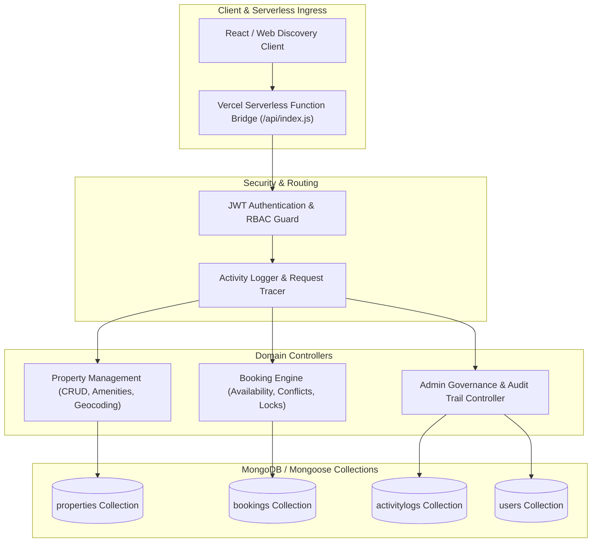

# HouseHunt — Full-Stack Real Estate Discovery & Rental Engine

[](https://nodejs.org/)
[](https://expressjs.com/)
[](https://www.mongodb.com/)
[](https://vercel.com/)
[](https://opensource.org/licenses/MIT)

A modern full-stack real estate property discovery and tenancy management platform engineered with **Node.js**, **Express**, and **MongoDB/Mongoose**. Provides automated property lifecycle management, date-bounded tenant booking workflows, role-based administration, and auditable activity logging.

---

## 🏛️ System Architecture



---

## ⚡ Core Domain Models & Schemas

- **`Property`**: Title, detailed description, property type (Apartment, Villa, Studio), rental pricing, deposit requirements, address & geospatial coordinates, image gallery URLs, verified amenities, and availability status.
- **`Booking`**: Tenant ID reference, Property ID reference, scheduled check-in and check-out timestamps, booking status (`PENDING`, `CONFIRMED`, `CANCELLED`), and transaction notes. Prevents temporal double-booking conflicts.
- **`User`**: Role-based entity distinguishing `TENANT`, `LANDLORD`, and `ADMIN` with bcrypt-hashed passwords.
- **`ActivityLog`**: Immutable audit records tracking admin approvals, listing mutations, and financial status transitions.

---

## 📂 Repository Structure

```text
househunt/
├── api/
│   └── index.js                # Vercel serverless entrypoint wrapper
├── backend/
│   ├── config/
│   │   └── db.js               # MongoDB connection lifecycle with retry logic
│   ├── controllers/
│   │   ├── adminController.js  # Backoffice audit & user management
│   │   ├── bookingController.js# Reservation & temporal conflict checking
│   │   └── propertyController.js# Property filtering, sorting, and pagination
│   ├── middleware/             # JWT auth & error interceptors
│   ├── Models/
│   │   ├── ActivityLog.js      # Immutable audit trail schema
│   │   ├── Booking.js          # Rental booking reservation schema
│   │   ├── Property.js         # Real estate property entity schema
│   │   └── User.js             # User credentials & RBAC profile schema
│   └── routes/                 # Express route declarations
├── .vercelignore               # Excludes development artifacts from deployment
├── package.json
└── README.md
```

---

## 🚀 Getting Started

### 1. Installation
```bash
git clone https://github.com/ak-bharadwaj/househunt.git
cd househunt
npm install
```

### 2. Configure Environment Variables
Create a `.env` file in the `backend/` directory:
```env
PORT=5000
MONGODB_URI=mongodb+srv://<username>:<password>@cluster.mongodb.net/househunt?retryWrites=true&w=majority
JWT_SECRET=your_super_secret_jwt_key
NODE_ENV=development
```

### 3. Run Development Server
```bash
npm run dev
# Or directly via Node
node backend/server.js
```
The API server starts at `http://localhost:5000`.

---

## 🌐 Serverless Deployment on Vercel
The repository includes an optimized serverless handler under `api/index.js` allowing seamless zero-configuration deployment on **Vercel**:
```bash
npm install -g vercel
vercel
```
